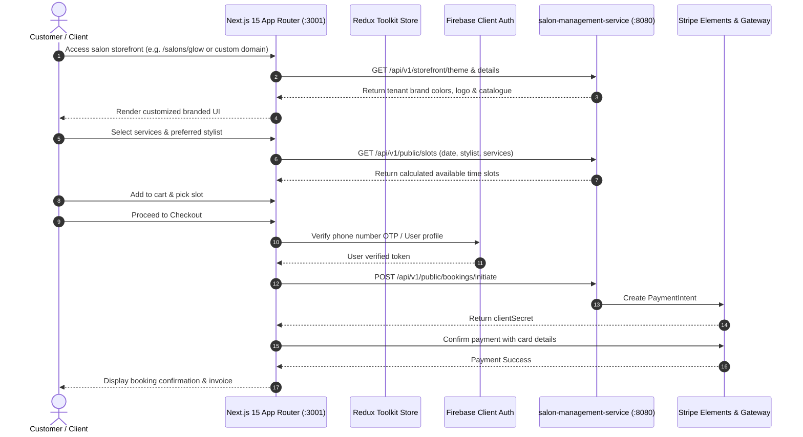

# ZenMonk Customer Storefront (`salon-public-app`)

A responsive, SEO-optimized, tenant-aware Next.js customer portal that enables clients to explore salons, discover stylists, browse treatment menus, reserve personalized time slots, and pay online.

---

## 1. Problem Statement

Booking a salon visit is often hindered by clumsy phone interactions, unclear pricing, and lack of visual stylist availability:
- **Client Inconvenience:** Customers want transparent service menus, customer reviews, photo galleries, specialist bios, and immediate slot confirmations.
- **Multi-Tenant Routing:** Each salon needs an independent digital storefront (either via custom subdomains/domains or salon slugs) matching the salon's personalized theme and branding without running separate applications.
- **Frictionless Checkout:** Customers require flexible payment options (cash or card via Stripe) and instant SMS/email confirmations.

**`salon-public-app`** solves this by providing a unified Next.js App Router customer portal supporting dynamic multi-tenant storefront rendering based on domain/subdomain or salon slug, real-time availability checks, cart management, and Stripe payments.

---

## 2. High-Level Functional Architecture & Booking Lifecycle Flow



---

## 3. Tech Stack

- **Framework:** Next.js 15 (App Router)
- **Language:** TypeScript
- **UI & Component System:** Material UI (MUI v7), Emotion (`@emotion/react`, `@emotion/styled`)
- **State Management:** Redux Toolkit (`@reduxjs/toolkit`, `react-redux`)
- **Authentication:** Firebase Client Auth (`firebase`)
- **Payments:** Stripe Elements (`@stripe/react-stripe-js`, `@stripe/stripe-js`)
- **Geocoding & Maps:** Mapbox Places API
- **Date Handling:** Dayjs

---

## 4. Setup & Running the Application

### Prerequisites
- Node.js (>= 18.x) and npm (for local runs)
- Docker & Docker Compose (for Docker runs)
- Backend service `salon-management-service` accessible on `http://localhost:8080`
- Firebase & Stripe client credentials
- Shared Docker network created (for Docker setups):
  ```bash
  docker network create salon_management_shared_network 2>/dev/null || true
  ```

### Environment Configuration
Create or configure `.env` in `salon-public-app`:
```bash
cp .env.example .env
```
Key configuration parameters:
```env
PORT=3001
APP_FORWARD_PORT=3001
NEXT_PUBLIC_APP_NAME="Veloura"
NEXT_PUBLIC_DEFAULT_SALON_SLUG="glow"
NEXT_PUBLIC_BASE_PATH=""
NEXT_PUBLIC_BACKEND_URL="http://localhost:8080"

# Firebase Client Authentication
NEXT_PUBLIC_FIREBASE_API_KEY="<your-firebase-api-key>"
NEXT_PUBLIC_FIREBASE_AUTH_DOMAIN="<your-firebase-auth-domain>"
NEXT_PUBLIC_FIREBASE_PROJECT_ID="<your-firebase-project-id>"
NEXT_PUBLIC_FIREBASE_APP_ID="<your-firebase-app-id>"

# Mapbox Geocoding API
NEXT_PUBLIC_MAPBOX_ACCESS_TOKEN="<your-mapbox-access-token>"
NEXT_PUBLIC_MAPBOX_BASE_URL="https://api.mapbox.com/geocoding/v5/mapbox.places"

# Stripe Client Payments
NEXT_PUBLIC_STRIPE_PUBLISHABLE_KEY="<your-stripe-publishable-key>"
```

---

### Running with Docker

#### A. Development Mode (via Docker Compose)
The project includes a `Dockerfile.dev` and `docker-compose.yml` for local containerized development:

```bash
# 1. Start the container in the background
docker compose up -d --build

# 2. Run the Next.js development server inside the running container
docker compose exec app npm run dev

# 3. View container logs
docker compose logs -f app

# 4. Stop container
docker compose down
```

#### B. Production Mode (Node.js Next.js Production Build)
Because `salon-public-app` is a dynamic Next.js App Router application with SSR/API routes, build and run it using the production Node runner:

```bash
# 1. Build production image with Next.js build
docker build -f Dockerfile.dev -t salon-public-app:prod .

# 2. Run the production container on port 3001
docker run -d \
  --name salon-user-app-prod \
  --network salon_management_shared_network \
  -p 3001:3001 \
  --env-file .env \
  salon-public-app:prod sh -c "npm install && npm run build && npm run start"

# 3. View container logs
docker logs -f salon-user-app-prod

# 4. Stop and remove container
docker stop salon-user-app-prod && docker rm salon-user-app-prod
```

---

### Running Locally on Host Machine

#### A. Development Mode
```bash
# Install dependencies
npm install

# Start Next.js development server (configured for port 3001)
npm run dev
```
Open `http://localhost:3001` to view the storefront.

#### B. Production Build & Start
```bash
# Build optimized Next.js bundle
npm run build

# Start production server
npm run start
```
